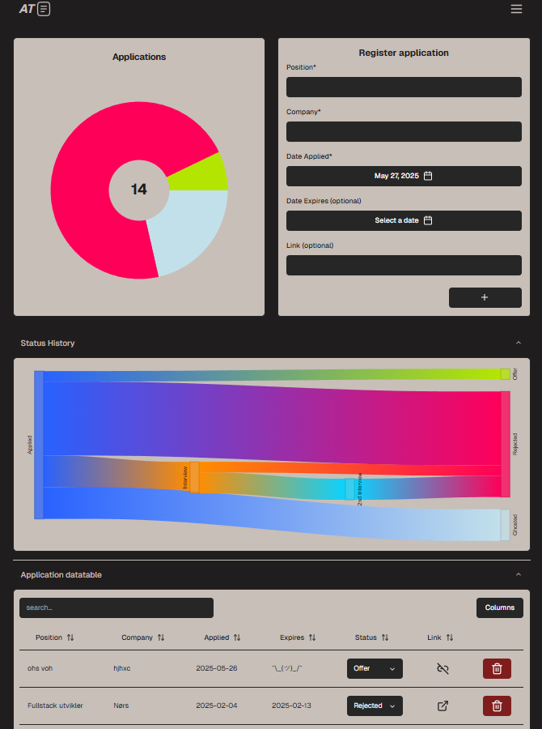

# Applitrack

A job application tracker designed to help you stay organized during your job search. It keeps a record of the positions you've applied to, the companies, and your progress through each application process.

In addition to tracking, Applitrack provides insightful statistics about your job hunt, visualized through an informative Sankey diagram.



# Stack
- [Vite + React](https://vitejs.dev/)
- [TanStack Router](https://tanstack.com/router)
- [Cloudflare Workers](https://developers.cloudflare.com/workers/) with [Hono](https://hono.dev/)
- [Cloudflare D1](https://developers.cloudflare.com/d1/) (SQLite) and [R2](https://developers.cloudflare.com/r2/) (attachments)
- [Tailwind CSS](https://tailwindcss.com/)
- [shadcn/ui](https://ui.shadcn.com/)
- [Zod](https://zod.dev/)
- [Zustand](https://zustand-demo.pmnd.rs/)
- [Clerk](https://clerk.com/)

# Features
- **Track Job Applications:** Easily add, update, and manage all your job applications in one place.
- **Status Management:** Monitor each application's progress (e.g., Applied, Interview, Offer, Rejected, Ghosted).
- **Statistics & Insights:** Get statistics on your application history, such as success rates with an interactive Sankey diagram.
- **Data Table:** View, sort, and filter your job applications in an interactive table.
- **Responsive Design:** Works seamlessly on desktop and mobile devices.
- **Modern UI:** Clean, user-friendly interface built with Tailwind CSS and shadcn/ui. With light/dark mode theme (dark by default to not flashbang your eyes)
- **Account Management:** Update password or delete your account at any time.

# Architecture

One Cloudflare Worker serves both the SPA and the API, from one origin:

```
browser ──► applitrack.sanan.no (Worker)
              ├── /api/*        → Hono routes
              │     ├── D1      applications, status history, status-flow view
              │     ├── R2      PDF attachments
              │     └── Clerk   session token verification
              └── everything else → static assets (frontend/dist), SPA fallback
```

There is no separate backend service, no container and no CORS layer. Static
assets are unmetered, and the API fits in the Workers free tier.

# Development

```sh
npm install                 # repo root; installs the frontend and worker workspaces

# API: http://localhost:8787 (needs worker/.dev.vars, see worker/README.md)
npm run worker:dev

# SPA with HMR: http://localhost:3000 (proxies /api to :8787)
npm run dev --workspace frontend
```

Tests and checks:

```sh
npm test                    # frontend (vitest, jsdom) + worker (vitest in workerd)
npm run typecheck           # worker TypeScript
```

# Database

Data lives in Cloudflare D1. The schema is one migration
(`worker/migrations/0001_init.sql`):

- **`applications`** — one row per job application (position, company, status,
  applied/expiry dates, link, attachment key).
- **`application_status_history`** — one row per status change (`from_status`
  → `to_status`), written by the API in the same batch as the status update.
- **`application_status_flow`** — a view aggregating status transitions per
  user, used to drive the Sankey diagram.

Datetimes are stored as fixed-width ISO-8601 UTC text, so text ordering is
chronological ordering. Applying migrations and importing data from an older
SQLite file are documented in [`worker/README.md`](worker/README.md).

# Deployment

Deploys are manual:

```sh
cd frontend && npm run build          # VITE_CLERK_* must be set (see .env.example)
cd ../worker && npm run db:migrate:remote && npm run deploy
```

Secrets (`CLERK_SECRET_KEY`, `CLERK_PUBLISHABLE_KEY`, `ATTACHMENT_SIGNING_KEY`),
the bindings in `wrangler.jsonc`, the custom domain and the data import are
covered in [`worker/README.md`](worker/README.md).

# Self-hosting

The previous self-hosted version — FastAPI + a SQLite file on a volume, packaged
as two Docker images and deployed with Dokploy — is preserved as-is on the
**`self-host`** branch, together with its full `SELF_HOSTING.md` guide. That
branch is frozen and only exists so the container setup can be brought back.

# License

[AGPL-3.0](LICENSE)
